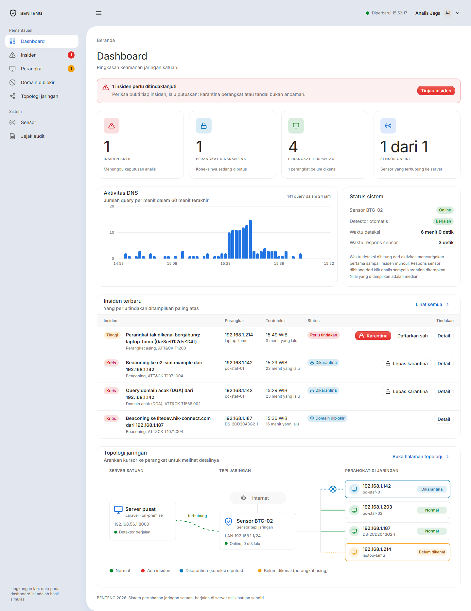
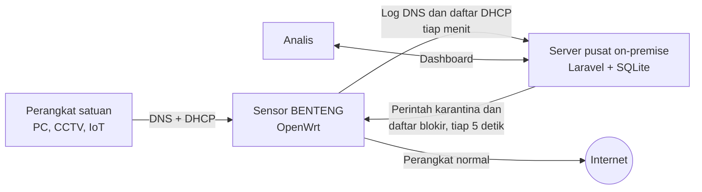
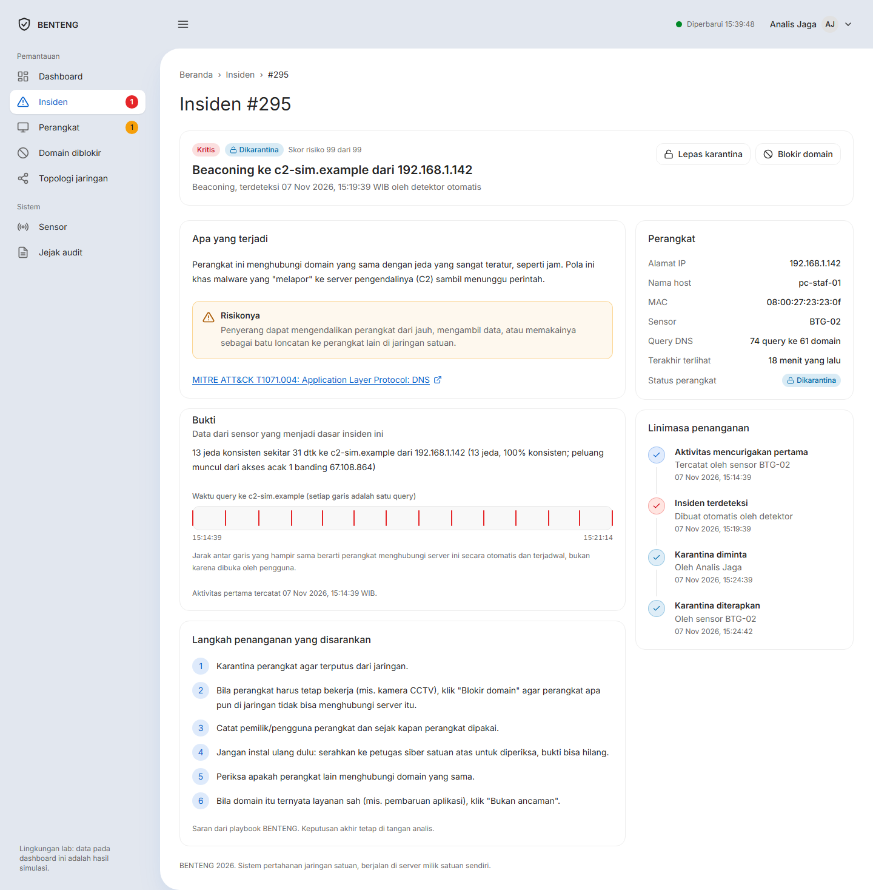
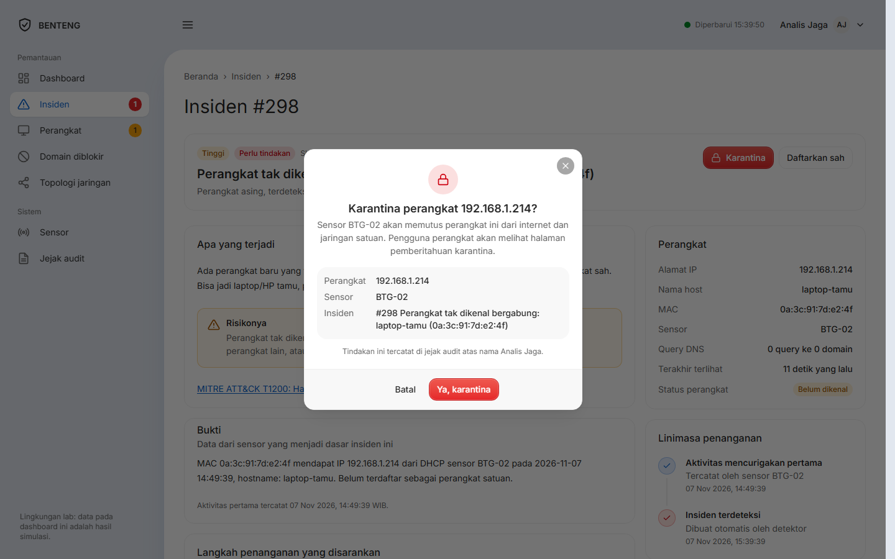
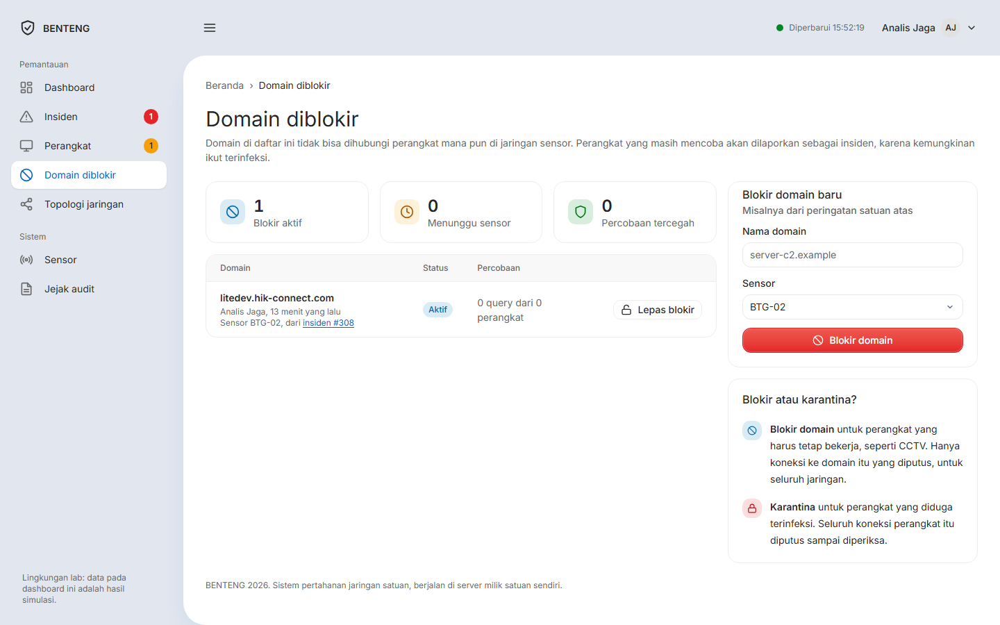

# BENTENG

**Sensor siber tepi untuk jaringan satuan yang tidak punya personel keamanan siber khusus.**

Kartika Cyber Hackathon 2026, kategori Defensive Shield (Penangkalan).

> **Video demo:** _(tautan menyusul)_

Sensor murah berbasis OpenWrt dipasang di gerbang jaringan satuan. Sensor mengenali perangkat yang berperilaku seperti terinfeksi, lalu analis memutuskan tindakan dari satu dashboard: **mengarantina satu perangkat** atau **memblokir domain untuk seluruh jaringan**. Semua berjalan di server milik satuan, tanpa layanan cloud asing.



*Tangkapan layar memakai data simulasi lab.*

## Yang dilakukan BENTENG

| Tahap | Kemampuan |
| --- | --- |
| **Deteksi otomatis** | Beaconing ke server pengendali (T1071.004), domain acak/DGA (T1568.002), dan perangkat tak dikenal di jaringan (T1200). Detektor berjalan tiap menit. |
| **Penjelasan** | Setiap insiden punya bukti, penjelasan bahasa awam, risiko, dan langkah penanganan, sehingga bisa dipahami operator non-ahli. |
| **Pemutusan** | Satu klik mengarantina perangkat lewat nftables di sensor. Pengguna perangkat melihat halaman pemberitahuan, dan karantina pulih sendiri setelah sensor reboot. |
| **Pencegahan** | Satu klik memblokir domain di DNS sensor untuk semua perangkat. Perangkat lain yang masih mencoba menghubunginya otomatis dilaporkan sebagai insiden baru. |
| **Akuntabilitas** | Login dengan peran analis dan pengamat. Setiap tindakan masuk jejak audit atas nama akun. |

Skenario IT/OT: kamera CCTV milik satuan yang rutin melapor ke server vendor di luar negeri bisa diblokir domainnya tanpa memutus kamera dari jaringan.

## Arsitektur



Sensor hanya membaca metadata (nama domain, MAC, nama host), bukan isi komunikasi.

## Hasil evaluasi

`php artisan benteng:deteksi --evaluasi --seed=1 --percobaan=100` menjalankan 11 skenario sebanyak 100 kali pada **data sintetis** (193.521 query):

- **Serangan terdeteksi: 599 dari 600 (99,8%)**
- **Alarm palsu pada trafik normal: 0 dari 300 (0%)**

Keterbatasan yang sudah diketahui: heartbeat aplikasi sah bisa mirip beacon (analis menandainya "Bukan ancaman"), dan DGA berbasis kamus belum terdeteksi. Rincian ada di [dokumentasi teknis](benteng-server/docs/README.md#8-skema-database-logika-deteksi--hasil-evaluasi).

Di lab, karantina diterapkan sensor 2–4 detik setelah analis mengklik dan blokir domain sekitar 7 detik.

## Tampilan

| Detail insiden dan bukti | Konfirmasi tindakan |
| --- | --- |
|  |  |
| **Domain diblokir** | **Topologi jaringan** |
|  |  |

## Menjalankan

Butuh PHP 8.5, Composer, dan Node.js.

```powershell
cd benteng-server
composer install
npm install; npm run build
copy .env.example .env
php artisan key:generate
# di .env: DB_CONNECTION=sqlite dan BENTENG_SENSOR_TOKEN=<token acak>
php artisan migrate
php artisan benteng:pengguna analis@satuan.mil --nama="Nama Analis"
php artisan serve --host=0.0.0.0 --port=8000
php artisan schedule:work   # di terminal kedua
```

- Sensor dan lab VirtualBox: [panduan pemasangan sensor](benteng-server/docs/PANDUAN-SENSOR.md)
- Test otomatis: `php artisan test`
- Uji kualitas detektor tanpa lab: `php artisan benteng:deteksi --evaluasi --percobaan=100`

## Isi repo

| Folder | Isi |
| --- | --- |
| [`benteng-server/`](benteng-server/) | Server pusat dan dashboard (Laravel) |
| [`benteng-server/docs/`](benteng-server/docs/) | Dokumentasi teknis dan panduan pemasangan |
| [`benteng-starter/sensor/`](benteng-starter/sensor/), [`responden/`](benteng-starter/responden/) | Skrip yang dipasang di sensor |
| [`benteng-starter/uji/`](benteng-starter/uji/) | Alat uji lab. Hanya menanyakan nama domain, bukan malware. |
