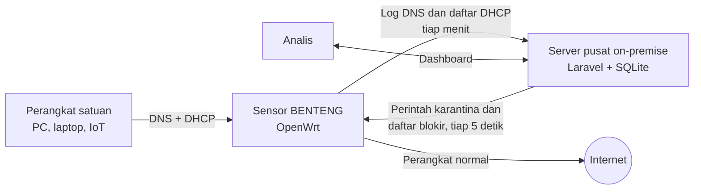
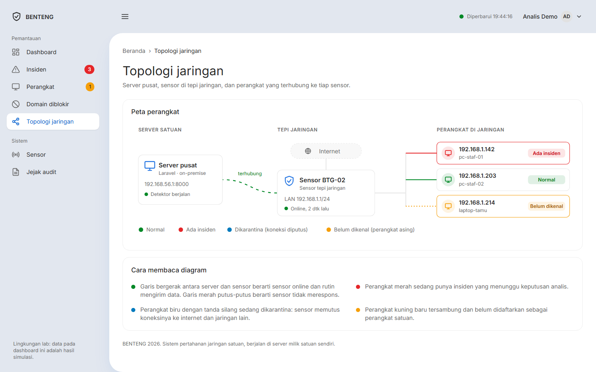

# BENTENG

**Sensor siber tepi untuk jaringan satuan yang tidak punya personel keamanan siber khusus.**

Kartika Cyber Hackathon 2026, kategori Defensive Shield (Penangkalan).

> **Video demo:** _(tautan menyusul)_

Sensor murah berbasis OpenWrt dipasang di gerbang jaringan satuan. Sensor mengenali perangkat yang berperilaku seperti terinfeksi, lalu analis memutuskan tindakan dari satu dashboard: **mengarantina satu perangkat** atau **memblokir domain untuk seluruh jaringan**. Semua berjalan di server milik satuan, tanpa layanan cloud asing.


*Tangkapan layar memakai data simulasi lab.*

## Yang dilakukan BENTENG

| Tahap | Kemampuan |
| --- | --- |
| **Deteksi otomatis** | Beaconing ke server pengendali (T1071.004), domain acak/DGA (T1568.002), dan perangkat tak dikenal di jaringan (T1200). Detektor berjalan tiap menit. |
| **Penjelasan** | Setiap insiden punya bukti, penjelasan bahasa awam, risiko, dan langkah penanganan, sehingga bisa dipahami operator non-ahli. |
| **Pemutusan** | Satu klik mengarantina perangkat lewat nftables di sensor. Pengguna perangkat melihat halaman pemberitahuan, dan karantina pulih sendiri setelah sensor reboot. |
| **Pencegahan** | Satu klik memblokir domain di DNS sensor untuk semua perangkat. Perangkat lain yang masih mencoba menghubunginya otomatis dilaporkan sebagai insiden baru. |
| **Akuntabilitas** | Login dengan peran analis dan pengamat. Setiap tindakan masuk jejak audit atas nama akun. |

## Arsitektur



Sensor hanya membaca metadata (nama domain, MAC, nama host), bukan isi komunikasi.

## Hasil evaluasi

`php artisan benteng:deteksi --evaluasi --seed=1 --percobaan=100` menjalankan 11 skenario sebanyak 100 kali pada **data sintetis** (193.521 query):

- **Serangan terdeteksi: 599 dari 600 (99,8%)**
- **Alarm palsu pada trafik normal: 0 dari 300 (0%)**

Keterbatasan yang sudah diketahui: heartbeat aplikasi sah bisa mirip beacon (analis menandainya "Bukan ancaman"), dan DGA berbasis kamus belum terdeteksi. Rincian ada di [dokumentasi teknis](benteng-server/docs/README.md#8-skema-database-logika-deteksi--hasil-evaluasi).

Di lab, karantina diterapkan sensor 2–4 detik setelah analis mengklik dan blokir domain sekitar 7 detik.

## Tampilan

| Detail insiden dan bukti | Konfirmasi tindakan |
| --- | --- |
|  |  |
| **Domain diblokir** | **Topologi jaringan** |
|  |  |

## Coba langsung (tanpa sensor dan tanpa VM)

Butuh PHP 8.5, Composer, dan Node.js. Pemasangan pertama sekitar 5 menit karena mengunduh dependensi.

```powershell
git clone https://github.com/hadiid-studentcode/benteng.git
cd benteng\benteng-server
composer setup   # sekali saja: dependensi, database, tampilan, akun dan data demo
composer demo    # setiap kali mencoba: data simulasi dibuat ulang, lalu server berjalan
```

Buka `http://localhost:8000` dan masuk dengan salah satu akun demo:

| Email | Kata sandi | Peran |
| --- | --- | --- |
| `analis@demo.local` | `analis-demo` | Analis: bisa mengarantina, memblokir domain, dan menutup insiden |
| `pengamat@demo.local` | `pengamat-demo` | Pengamat: hanya melihat |

Mode demo berisi data simulasi 25 menit terakhir: PC staf yang terinfeksi (beaconing dan domain acak), PC staf lain yang normal, dan laptop tamu yang belum dikenal. Sensornya ditiru oleh server, jadi karantina dan blokir domain "diterapkan" sekitar 2 detik setelah diklik. Pada lab sungguhan, perintah yang sama dijalankan oleh sensor OpenWrt (2-4 detik untuk karantina).

Uji kualitas detektor dan test otomatis, dari folder yang sama:

```powershell
php artisan benteng:deteksi --evaluasi --seed=1 --percobaan=100
php artisan test
```

- Perintah evaluasi menjalankan 11 skenario serangan dan trafik normal sebanyak 100 kali, lalu mencetak angka yang sama dengan [Hasil evaluasi](#hasil-evaluasi): 599/600 terdeteksi dan 0/300 alarm palsu.
- `php artisan test` menjalankan 63 test otomatis: ingest data sensor, deteksi, karantina, blokir domain, login dan peran, jejak audit, serta mode demo.

## Menjalankan dengan sensor sungguhan

Untuk lab VirtualBox atau router OpenWrt, ikuti [panduan pemasangan sensor](benteng-server/docs/PANDUAN-SENSOR.md). Di `.env`, isi `BENTENG_MODE_DEMO=false` dan samakan `BENTENG_SENSOR_TOKEN` dengan token di skrip sensor, lalu jalankan:

```powershell
php artisan benteng:pengguna analis@satuan.mil --nama="Nama Analis"   # kata sandi acak ditampilkan
php artisan serve --host=0.0.0.0 --port=8000
php artisan schedule:work   # di terminal kedua: detektor otomatis tiap menit
```

## Isi repo

| Folder | Isi |
| --- | --- |
| [`benteng-server/`](benteng-server/) | Server pusat dan dashboard (Laravel) |
| [`benteng-server/docs/`](benteng-server/docs/) | Dokumentasi teknis dan panduan pemasangan |
| [`benteng-starter/sensor/`](benteng-starter/sensor/), [`responden/`](benteng-starter/responden/) | Skrip yang dipasang di sensor |
| [`benteng-starter/uji/`](benteng-starter/uji/) | Alat uji lab. Hanya menanyakan nama domain, bukan malware. |

## Lisensi

[MIT](LICENSE). Tampilan memakai [Stisla](https://github.com/stisla/stisla) dan tata letak template Meridian, keduanya berlisensi MIT ([catatan lisensi](benteng-server/resources/css/meridian/LICENSE)).
