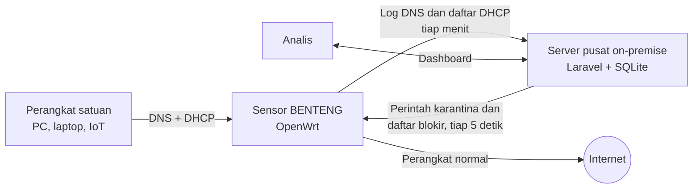

<p align="center">
  <picture>
    <source media="(prefers-color-scheme: dark)" srcset="benteng-server/public/assets/images/logo-terang.png">
    
  </picture>
</p>

<p align="center"><b>Sensor siber tepi untuk jaringan satuan yang tidak punya personel keamanan siber khusus.</b><br>
Kartika Cyber Hackathon 2026 · Defensive Shield (Penangkalan)</p>

> **Video demo:** _(tautan menyusul)_

Sensor murah berbasis OpenWrt dipasang di gerbang jaringan satuan. Sensor mengenali perangkat yang berperilaku seperti terinfeksi, lalu analis memutuskan tindakan dari satu dashboard: **mengarantina satu perangkat** atau **memblokir domain untuk seluruh jaringan**. Semua berjalan di server milik satuan, tanpa layanan cloud asing.


*Tangkapan layar memakai data simulasi.*

## Daftar isi

- [Yang dilakukan BENTENG](#yang-dilakukan-benteng)
- [Arsitektur](#arsitektur)
- [Hasil evaluasi](#hasil-evaluasi)
- [Cara mencoba](#cara-mencoba)
  - [Cara 1: Mode demo](#cara-1-mode-demo) (tanpa sensor, sekitar 5 menit)
  - [Cara 2: Lab VirtualBox](#cara-2-lab-virtualbox) (sensor dan korban di VM)
  - [Cara 3: Router OpenWrt](#cara-3-router-openwrt) (perangkat sungguhan)
  - [Cara 4: Mode demo di hosting](#cara-4-mode-demo-di-hosting)
- [Tampilan](#tampilan)
- [Uji kualitas dan test otomatis](#uji-kualitas-dan-test-otomatis)
- [Isi repo](#isi-repo)

## Yang dilakukan BENTENG

| Tahap | Kemampuan |
| --- | --- |
| **Deteksi otomatis** | Beaconing ke server pengendali (T1071.004), domain acak/DGA (T1568.002), dan perangkat tak dikenal di jaringan (T1200). Detektor berjalan tiap menit. |
| **Penjelasan** | Setiap insiden punya bukti, penjelasan bahasa awam, risiko, dan langkah penanganan, sehingga bisa dipahami operator non-ahli. |
| **Pemutusan** | Satu klik mengarantina perangkat lewat nftables di sensor. Pengguna perangkat melihat halaman pemberitahuan, dan karantina pulih sendiri setelah sensor reboot. |
| **Pencegahan** | Satu klik memblokir domain di DNS sensor untuk semua perangkat. Perangkat lain yang masih mencoba menghubunginya otomatis dilaporkan sebagai insiden baru. |
| **Akuntabilitas** | Login dengan peran analis dan pengamat. Setiap tindakan masuk jejak audit atas nama akun. |

## Arsitektur



Sensor hanya membaca metadata (nama domain, MAC, nama host), bukan isi komunikasi. Sensor yang menghubungi server, bukan sebaliknya, sehingga server tidak perlu membuka akses masuk ke jaringan sensor.

## Hasil evaluasi

`php artisan benteng:deteksi --evaluasi --seed=1 --percobaan=100` menjalankan 11 skenario sebanyak 100 kali pada **data sintetis** (193.521 query):

- **Serangan terdeteksi: 599 dari 600 (99,8%)**
- **Alarm palsu pada trafik normal: 0 dari 300 (0%)**

Keterbatasan yang sudah diketahui: heartbeat aplikasi sah bisa mirip beacon (analis menandainya "Bukan ancaman"), dan DGA berbasis kamus belum terdeteksi. Rincian ada di [dokumentasi teknis](benteng-server/docs/README.md#8-skema-database-logika-deteksi--hasil-evaluasi).

Di lab VirtualBox, karantina diterapkan sensor 2–4 detik setelah analis mengklik, dan blokir domain sekitar 7 detik.

## Cara mencoba

| | Butuh | Waktu | Hasilnya |
| --- | --- | --- | --- |
| [**1. Mode demo**](#cara-1-mode-demo) | PHP 8.4.1+, Composer, Node.js | ±5 menit | Dashboard berisi data simulasi; sensor ditiru server |
| [**2. Lab VirtualBox**](#cara-2-lab-virtualbox) | Laptop dengan VirtualBox 7, RAM 8 GB | 45–60 menit | Sensor OpenWrt dan VM korban sungguhan di satu laptop |
| [**3. Router OpenWrt**](#cara-3-router-openwrt) | Router yang didukung OpenWrt 24.10, laptop/PC server | 45–60 menit | BENTENG menjaga jaringan sungguhan |
| [**4. Hosting**](#cara-4-mode-demo-di-hosting) | VPS atau hosting dengan PHP 8.4.1+, SSH, cron | ±30 menit | Mode demo yang bisa dibuka siapa saja lewat internet |

Semua perintah di bawah dijalankan dari folder hasil `git clone https://github.com/hadiid-studentcode/benteng.git`. Server berjalan di Windows, Linux, maupun macOS.

### Cara 1: Mode demo

```sh
cd benteng-server
composer setup   # sekali saja: dependensi, database, tampilan, akun dan data demo
composer demo    # setiap kali mencoba: data simulasi dibuat ulang, lalu server berjalan
```

Buka `http://localhost:8000` dan masuk dengan salah satu akun demo:

| Email | Kata sandi | Peran |
| --- | --- | --- |
| `analis@demo.local` | `analis-demo` | Analis: bisa mengarantina, memblokir domain, dan menutup insiden |
| `pengamat@demo.local` | `pengamat-demo` | Pengamat: hanya melihat |

Yang bisa dicoba:

1. Dashboard sudah berisi data simulasi 25 menit terakhir: PC staf yang terinfeksi (beaconing dan domain acak), PC staf lain yang normal, dan laptop tamu yang belum dikenal.
2. Tekan **Coba simulasi serangan** di dashboard untuk memunculkan PC terinfeksi atau perangkat asing baru. Insidennya terdeteksi dalam beberapa detik.
3. Buka detail insiden, lalu klik **Karantina** atau **Blokir domain**. Sensornya ditiru server, jadi tindakan "diterapkan" sekitar 2 detik kemudian dan tercatat di **Jejak audit**.

Mode demo ditandai label **Mode demo** di bagian atas dashboard. Mode ini menolak berjalan bila database sudah berisi data lab sungguhan.

### Cara 2: Lab VirtualBox

Sensor OpenWrt dan VM korban berjalan sebagai VM di laptop yang sama dengan server.

1. **Buat VM sensor.** Ikuti [panduan sensor langkah 2A](benteng-server/docs/PANDUAN-SENSOR.md#2a-sensor-di-virtualbox-jalur-a): unduh OpenWrt, buat VM dengan tiga adapter jaringan, lalu atur alamat manajemen di konsol VM. Selesai bila `ping 192.168.56.20` dibalas.
2. **Pasang semuanya sekali jalan.** Skrip ini menyiapkan server, menyalakan dashboard dan detektor, lalu memasang dan memeriksa skrip BENTENG di sensor:

   ```powershell
   # Windows
   powershell -ExecutionPolicy Bypass -File benteng-starter\pasang-sensor.ps1 -Jalur vm
   ```

   ```sh
   # Linux atau macOS
   bash benteng-starter/pasang-sensor.sh vm
   ```

   Kata sandi root sensor diminta sekali, dan akun analis dibuat bila belum ada (kata sandinya ditampilkan sekali).
3. **Buat VM korban dan uji.** Ikuti [panduan sensor langkah 6A dan 7](benteng-server/docs/PANDUAN-SENSOR.md#6a-vm-korban-jalur-a): VM Alpine kecil yang menjalankan alat uji, lalu karantina dan blokir domain.

Lebih suka memasang langkah demi langkah? Semua yang dikerjakan skrip juga tertulis manual di [panduan sensor](benteng-server/docs/PANDUAN-SENSOR.md).

### Cara 3: Router OpenWrt

Sama dengan Cara 2, tetapi sensornya router sungguhan dan perangkat ujinya laptop/PC di jaringan router.

1. **Siapkan router.** Ikuti [panduan sensor langkah 2B](benteng-server/docs/PANDUAN-SENSOR.md#2b-sensor-di-router-openwrt-jalur-b): pasang OpenWrt 24.10, colok server ke port LAN, dan kunci alamat server.
2. **Pasang semuanya sekali jalan**, dari laptop/PC server yang tersambung ke LAN router:

   ```powershell
   # Windows
   powershell -ExecutionPolicy Bypass -File benteng-starter\pasang-sensor.ps1 -Jalur router
   ```

   ```sh
   # Linux atau macOS
   bash benteng-starter/pasang-sensor.sh router
   ```

   Alamat server dideteksi otomatis dari alamat `192.168.1.x` komputer ini.
3. **Uji** dengan laptop/PC Linux di jaringan router: [panduan sensor langkah 6B dan 7](benteng-server/docs/PANDUAN-SENSOR.md#6b-perangkat-uji-di-jaringan-router-jalur-b).

Jalur yang diuji tim adalah lab VirtualBox. Router sungguhan memakai skrip dan konfigurasi yang sama; bedanya hanya pada alamat sensor dan server.

### Cara 4: Mode demo di hosting

Server butuh PHP 8.4.1 atau lebih baru dengan ekstensi `pdo_sqlite`, Composer, akses SSH, dan cron. Hosting yang hanya menyediakan PHP 8.3 tidak bisa dipakai, karena beberapa dependensi mensyaratkan PHP 8.4.1.

1. Arahkan document root domain ke folder `benteng-server/public`, dan pakai HTTPS.
2. Di server, dari folder `benteng-server`:

   ```sh
   composer install --no-dev --optimize-autoloader
   cp .env.example .env
   php artisan key:generate
   touch database/database.sqlite
   php artisan migrate --force
   php artisan benteng:siapkan-demo
   php artisan config:cache && php artisan route:cache && php artisan view:cache
   ```

   Bila server tidak punya Node.js, jalankan `npm install && npm run build` di komputer sendiri lalu unggah folder `public/build`.
3. Di `.env`, isi `APP_ENV=production`, `APP_DEBUG=false`, dan `APP_URL=https://domain-anda`, lalu jalankan ulang `php artisan config:cache`.
4. Tambahkan cron agar data demo dibuat ulang setiap jam:

   ```
   * * * * * cd /path/ke/benteng-server && php artisan schedule:run >> /dev/null 2>&1
   ```

Semua pengunjung memakai akun demo yang sama, jadi tindakan satu orang terlihat oleh yang lain sampai data dibuat ulang. Folder `storage`, `bootstrap/cache`, dan `database` harus bisa ditulis oleh web server.

## Tampilan

| Detail insiden dan bukti | Konfirmasi tindakan |
| --- | --- |
|  |  |
| **Domain diblokir** | **Topologi jaringan** |
|  |  |

## Uji kualitas dan test otomatis

Dari folder `benteng-server`, setelah `composer install`:

```sh
php artisan benteng:deteksi --evaluasi --seed=1 --percobaan=100
php artisan test
```

- Perintah evaluasi menjalankan 11 skenario serangan dan trafik normal sebanyak 100 kali, lalu mencetak angka yang sama dengan [Hasil evaluasi](#hasil-evaluasi).
- `php artisan test` menjalankan 66 test otomatis: ingest data sensor, deteksi, karantina, blokir domain, login dan peran, jejak audit, serta mode demo dan simulasi.

## Isi repo

| Folder | Isi |
| --- | --- |
| [`benteng-server/`](benteng-server/) | Server pusat dan dashboard (Laravel) |
| [`benteng-server/docs/`](benteng-server/docs/) | [Dokumentasi teknis](benteng-server/docs/README.md) dan [panduan sensor](benteng-server/docs/PANDUAN-SENSOR.md) |
| [`benteng-starter/`](benteng-starter/) | Skrip pemasangan sekali jalan (`pasang-sensor.ps1`, `pasang-sensor.sh`, `pasang.sh`) |
| [`benteng-starter/sensor/`](benteng-starter/sensor/), [`responden/`](benteng-starter/responden/) | Skrip yang dipasang di sensor |
| [`benteng-starter/uji/`](benteng-starter/uji/) | Alat uji lab. Hanya menanyakan nama domain, bukan malware. |

## Lisensi

[MIT](LICENSE). Tampilan memakai [Stisla](https://github.com/stisla/stisla) dan tata letak template Meridian, keduanya berlisensi MIT ([catatan lisensi](benteng-server/resources/css/meridian/LICENSE)).
