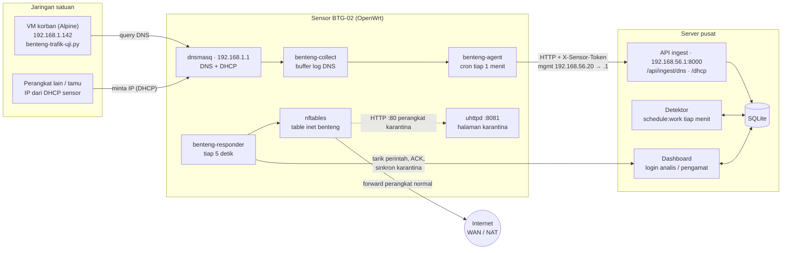
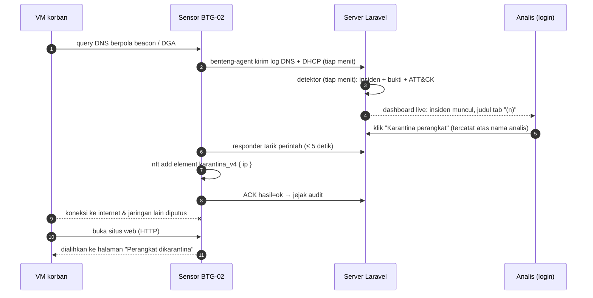
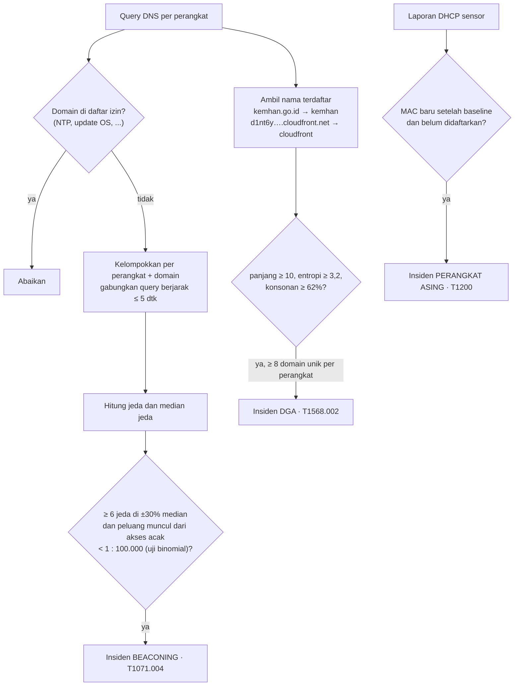

# BENTENG — Sensor Siber Tepi untuk Jaringan Satuan

> Proyek untuk **Kartika Cyber Hackathon 2026** (PUSSIBERAD × CODEPOLITAN),
> kategori **Penangkalan**. Deadline submission: **15 November 2026**.

BENTENG adalah sistem pertahanan jaringan untuk satuan kecil TNI AD yang tidak
punya personel keamanan siber khusus. Sensor berbasis **OpenWrt** dipasang di
tepi jaringan satuan untuk mendeteksi dan memblokir ancaman, lalu dikelola dari
satu **dashboard pusat**. Analis melihat insiden, membaca penjelasannya, dan
mengarantina perangkat dengan satu klik. Semua berjalan **on-premise**, tanpa
layanan cloud asing.

Analoginya: BENTENG adalah "satpam pintar" di gerbang jaringan satuan yang
menolak tamu berbahaya, mengenali gerak-gerik mencurigakan, mencatat siapa yang
masuk, dan mengisolasi perangkat yang terinfeksi.

---

## 1. Status proyek (per 25 Okt 2026)

**Sudah selesai dan teruji:**
- ✅ Sensor OpenWrt mencatat query DNS (dnsmasq) dan daftar DHCP, mengirim ke server tiap menit.
- ✅ Server Laravel menerima & menyimpan DNS ke SQLite (anti-dobel via `line_hash`).
- ✅ Detektor **otomatis tiap menit** (`php artisan schedule:work`) menemukan:
  - **beaconing** (T1071.004) dengan uji statistik binomial,
  - **DGA** (T1568.002) berdasarkan nama domain terdaftar (bukan subdomain CDN),
  - **perangkat asing** (T1200): MAC baru yang muncul di DHCP setelah baseline.
- ✅ **Evaluasi kualitas deteksi** yang bisa diulang: `php artisan benteng:deteksi --evaluasi --percobaan=100`
  → deteksi serangan **99,8%**, alarm palsu trafik normal **0%** (lihat bagian 8).
- ✅ Dashboard `/dashboard` live (segar tiap 5 dtk tanpa kedip): status sensor & detektor,
  **diagram topologi jaringan live**, grafik aktivitas DNS, insiden + bukti visual + playbook
  bahasa Indonesia, jalur perintah ke sensor, jejak audit, tabel perangkat.
- ✅ **Login & peran**: `analis` (bisa bertindak) dan `pengamat` (hanya melihat, mis. pimpinan).
  Setiap tindakan tercatat atas nama akun di `audit_logs`.
- ✅ Karantina: tombol di dashboard → sensor menjalankan `nftables` → koneksi
  perangkat putus. Berlaku per perangkat (semua insiden perangkat itu ikut).
- ✅ **Halaman karantina** di perangkat korban: akses web (HTTP) dialihkan ke halaman
  pemberitahuan di sensor.
- ✅ **Sinkronisasi karantina**: set nftables yang hilang saat sensor reboot dipulihkan
  otomatis dari server (saat responder mulai dan tiap menit).
- ✅ Waktu deteksi dan waktu respons sensor diukur dan ditampilkan (median).

**Belum dikerjakan (roadmap):**
- ⬜ Penjelasan insiden dengan LLM lokal (saat ini template playbook).
- ⬜ Deteksi DGA berbasis kamus (model n-gram/ML) — keterbatasan yang sudah terdokumentasi.
- ⬜ Token per sensor + kanal WireGuard sensor↔server.
- ⬜ Materi submission: video demo, slide, proposal, repo GitHub rapi (README di root).

---

## 2. Arsitektur

### 2a. Topologi perangkat (siapa tersambung ke siapa)



Diagram yang sama tampil **live** di dashboard (panel *Topologi jaringan*):
warna perangkat mengikuti status (normal, insiden, dikarantina, belum dikenal),
garis server↔sensor bergerak saat sensor online dan menjadi merah putus-putus
saat sensor tidak merespons.

### 2b. Alur deteksi sampai karantina



**Prinsip desain yang dipegang (penting saat menambah fitur):**
1. **Perilaku di atas konten** — deteksi pola koordinasi/keteraturan, bukan isi/opini.
2. **Setiap klaim ada buktinya** — insiden selalu punya kolom `bukti`, beacon digambar sebagai garis waktu.
3. **Human-in-the-loop** — sistem memberi saran; karantina butuh klik analis yang login.
4. **Siap berdaulat** — semua on-premise, tanpa API cloud asing.
5. **Jujur** — data lab ditandai simulasi; keterbatasan deteksi diukur dan ditulis.

---

## 3. Lingkungan lab (VirtualBox di Windows 11, RAM 8 GB)

| Mesin | OS | IP | Jaringan VirtualBox |
| --- | --- | --- | --- |
| `benteng-sensor` | OpenWrt 24.10.8 x86 (EFI) | LAN 192.168.1.1 · mgmt 192.168.56.20 | Adapter1 Internal `benteng-lan`, Adapter2 NAT, Adapter3 Host-only |
| `benteng-korban` | Alpine Linux | 192.168.1.142 (DHCP dari sensor) | Adapter1 Internal `benteng-lan` |
| Server | Windows 11 host | 192.168.56.1 (host-only) | — |

Catatan lab: VirtualBox NAT tidak punya IPv6, jadi sensor memakai
`filter_aaaa=1` di dnsmasq. Di lapangan (jaringan ber-IPv6), opsi ini tidak perlu.

Di lapangan, "sensor" = router OpenWrt fisik atau mini-PC x86; tidak terikat VM.

---

## 4. Tech stack

- **Sensor:** OpenWrt 24.10.8, dnsmasq, nftables, uhttpd, paket `conntrack`,
  skrip shell (ash/BusyBox) + procd init.
- **Server:** PHP 8.5 + Laravel 13 (via FlyEnv di Windows), **SQLite**, Blade.
  Tidak pakai Docker/Python agar muat di 8 GB RAM.
- **Komunikasi sensor↔server:** HTTP + header token `X-Sensor-Token`.
  (Di lapangan idealnya lewat WireGuard; di lab via host-only.)
- **Link project (rencana submission):** repo GitHub + video. Tanpa VPS.

---

## 5. Struktur repo

```
benteng/
├─ benteng-server/                         # proyek Laravel (server pusat)
│  ├─ app/Http/Controllers/
│  │  ├─ IngestController.php               # terima DNS & DHCP dari sensor
│  │  ├─ CommandController.php              # perintah, ACK, sinkron karantina untuk sensor
│  │  ├─ DashboardController.php            # dashboard + karantina/false positive/lepas
│  │  └─ SesiController.php                 # login / logout
│  ├─ app/Console/Commands/
│  │  ├─ DeteksiCommand.php                 # detektor + --evaluasi
│  │  └─ BuatPenggunaCommand.php            # php artisan benteng:pengguna
│  ├─ app/Models/User.php                   # peran analis / pengamat
│  ├─ config/benteng.php                    # token, ambang, playbook, info topologi
│  ├─ database/migrations/                  # dns_events, incidents, commands+audit_logs, perangkat, ...
│  ├─ resources/views/benteng/              # dashboard.blade.php, login.blade.php
│  ├─ routes/{web.php, api.php, console.php}
│  ├─ tests/Feature/                        # 35 test (php artisan test)
│  └─ docs/README.md                        # dokumen ini
│
└─ benteng-starter/                        # file untuk sensor & lab (disalin via scp)
   ├─ sensor/
   │  ├─ benteng-collect(.init)             # -> /usr/bin, /etc/init.d   (buffer log DNS)
   │  └─ benteng-agent                      # -> /usr/bin/benteng-agent   (kirim DNS + DHCP, cron 1 menit)
   ├─ responden/
   │  ├─ benteng-responder(.init)           # -> /usr/bin, /etc/init.d   (perintah + sinkron karantina)
   │  ├─ benteng-nft.conf                   # -> /etc/benteng/benteng-nft.conf
   │  └─ www-benteng/index.html             # -> /www-benteng/index.html (halaman karantina)
   ├─ uji/benteng-trafik-uji.py             # alat uji di VM korban. BUKAN malware.
   └─ server/                               # arsip langkah 1 (versi awal, tidak dipakai lagi)
```

---

## 6. Alur data

**6a. Pengumpulan DNS & DHCP**
1. VM korban meng-query domain → resolver = sensor (192.168.1.1).
2. dnsmasq menulis `query[...] ... from <ip>` ke log sistem.
3. `benteng-collect` (service) menyalin baris query ke `/tmp/benteng-dns.buf`.
4. `benteng-agent` (cron, tiap menit):
   - mengirim isi `/tmp/dhcp.leases` ke `POST /api/ingest/dhcp`;
   - memindahkan buffer DNS ke `.send`, lalu mengirim **baris log mentah** ke
     `POST /api/ingest/dns`. Sukses dinilai dari isi balasan (`"diterima"`).
5. `IngestController@dns` mem-parse tiap baris, simpan ke `dns_events` dengan
   `line_hash` unik → `insertOrIgnore` (anti-dobel saat kirim ulang).
6. `IngestController@dhcp` memperbarui tabel `perangkat`. **Laporan DHCP pertama
   sebuah sensor menjadi baseline** (perangkat di dalamnya dianggap sah);
   MAC yang muncul sesudahnya berstatus *belum dikenal*.

**6b. Deteksi**
7. Scheduler menjalankan `benteng:deteksi` tiap menit → menulis `incidents`
   (unik via kolom `sidik`, aman dijalankan berulang) beserta `mulai_pada`
   (waktu bukti pertama) untuk mengukur waktu deteksi.

**6c. Respons (karantina)**
8. Analis klik **Karantina** → `DashboardController@karantina` membuat baris di
   `commands`, menandai **semua insiden aktif perangkat itu** `dikarantina`,
   menulis `audit_logs` atas nama akun analis.
9. `benteng-responder` (loop 5 dtk) GET `/api/sensors/BTG-02/commands` →
   `<id> quarantine <ip>` → `nft add element inet benteng karantina_v4 { <ip> }`.
10. Responder ACK ke `/api/sensors/BTG-02/commands/{id}/ack?hasil=ok` → `audit_logs`.
11. Perangkat karantina: forward di-drop; HTTP port 80 dialihkan ke uhttpd :8081
    (halaman karantina). DNS ke sensor tetap jalan sehingga aktivitasnya tetap tercatat.
12. Saat mulai dan tiap menit, responder GET `/api/sensors/BTG-02/karantina` dan
    menambahkan lagi IP yang seharusnya dikarantina (set nftables hilang saat reboot).
13. **Lepas** = aksi `unquarantine` → `nft delete element ...`.

---

## 7. Routes

`routes/api.php` (autentikasi: header `X-Sensor-Token`):
```php
Route::post('/ingest/dns', [IngestController::class, 'dns']);
Route::post('/ingest/dhcp', [IngestController::class, 'dhcp']);
Route::get('/sensors/{sensor}/commands', [CommandController::class, 'ambil']);
Route::post('/sensors/{sensor}/commands/{id}/ack', [CommandController::class, 'ack']);
Route::get('/sensors/{sensor}/karantina', [CommandController::class, 'karantina']);
```

`routes/web.php`:
```php
Route::redirect('/', '/dashboard');
// guest: GET/POST /login (POST dibatasi 5x per menit)
// auth:  POST /logout, GET /dashboard
// auth + can:bertindak (hanya peran analis):
Route::post('/dashboard/incidents/{id}/karantina', ...)->name('benteng.karantina');
Route::post('/dashboard/incidents/{id}/false-positive', ...)->name('benteng.false-positive');
Route::post('/dashboard/incidents/{id}/lepas', ...)->name('benteng.lepas');
```

`routes/console.php`: `Schedule::command('benteng:deteksi')->everyMinute()->withoutOverlapping();`

---

## 8. Skema database, logika deteksi & hasil evaluasi

**Tabel:**
- `dns_events`: sensor, queried_at, qtype, domain, client_ip, **line_hash (unique)**.
- `perangkat`: sensor, mac, ip, hostname, **dikenal**, pertama_terlihat, terakhir_terlihat; unik (sensor, mac).
- `incidents`: sensor, client_ip, jenis (`beaconing`|`dga`|`perangkat_asing`), tingkat
  (`kritis`|`tinggi`), skor (0–99), judul, attck, bukti, **mulai_pada**, status
  (`baru`|`dikarantina`|`false_positive`), **sidik (unique)**.
- `commands`: sensor, aksi (`quarantine`|`unquarantine`), target_ip, incident_id,
  status (`pending`|`selesai`|`gagal`), hasil, diambil_pada, selesai_pada.
- `audit_logs`: pelaku (nama akun | `sensor:BTG-02`), **user_id**, aksi, target, incident_id, created_at.
- `users`: + kolom **peran** (`analis`|`pengamat`).



**Kenapa uji binomial?** Pada akses acak manusia, hanya ~21% jeda yang kebetulan
jatuh di ±30% median. Ambang lama "≥ 6 jeda konsisten" (dan versi "≥ 50% jeda")
terbukti salah tangkap: dengan ratusan pasangan perangkat–domain per jam, pasti
ada yang kebetulan 6 dari 11 jeda konsisten. Uji binomial menanyakan *berapa
peluang pola sekonsisten ini muncul dari akses acak*; di bawah 1 banding 100.000
baru disebut beacon. Peluang itu ikut ditulis di kolom bukti.

**Kenapa nama terdaftar untuk DGA?** Logika lama menilai label terpanjang,
sehingga 26 dari 30 nama CDN sah seperti `d1nt6ywwhy4kxl.cloudfront.net`
dianggap DGA. DGA malware menghasilkan *domain terdaftar* acak, jadi yang dinilai
adalah nama terdaftarnya (mendukung `.go.id`, `.mil.id`, `.co.id`, dst.).

**Hasil evaluasi** — `php artisan benteng:deteksi --evaluasi --seed=1 --percobaan=100`
(11 skenario × 100 percobaan, 193.521 query sintetis, 60 menit per perangkat):

| Kelompok | Skenario | Diharapkan | Sesuai |
| --- | --- | --- | --- |
| serangan | Beacon C2 tetap 30 dtk (alat uji lab) | beaconing | 100/100 |
| serangan | Beacon C2 jitter ±20% | beaconing | 100/100 |
| serangan | Beacon C2 jitter ±50% | beaconing | 99/100 |
| serangan | Beacon lambat tiap 5 menit | beaconing | 100/100 |
| serangan | DGA 40 domain acak | dga | 100/100 |
| serangan | CCTV/IoT melapor ke cloud vendor tiap 60 dtk | beaconing | 100/100 |
| normal | Penjelajahan web 3 pengguna | tidak ada insiden | 100/100 |
| normal | NTP dan pembaruan OS | tidak ada insiden | 100/100 |
| normal | CDN dengan subdomain acak | tidak ada insiden | 100/100 |
| keterbatasan | Heartbeat aplikasi sah tiap 5 menit | beaconing (alarm palsu diketahui) | 100/100 |
| keterbatasan | DGA berbasis kamus (kata bermakna) | tidak terdeteksi | 100/100 |

- **Tingkat deteksi serangan: 599/600 (99,8%)**
- **Alarm palsu pada trafik normal: 0/300 (0%)**
- Keterbatasan ditulis apa adanya: heartbeat aplikasi sah mirip beacon (analis
  menandai false positive, pola itu tidak dilaporkan ulang); DGA berbasis kamus
  lolos dan menjadi roadmap.

Data sintetis memakai seed tetap sehingga hasilnya selalu sama. Validasi di lab
nyata: jalankan `benteng-trafik-uji.py --mode normal --menit 60` di VM korban;
dashboard seharusnya tidak menampilkan insiden baru. (Selama pengembangan,
query NTP korban tiap ~70 dtk ke `pool.ntp.org` juga tidak memicu alarm berkat daftar izin.)

---

## 9. Setup dari nol (ringkas)

**Server (Windows, FlyEnv):**
```powershell
cd benteng-server
composer install
# .env: DB_CONNECTION=sqlite  +  BENTENG_SENSOR_TOKEN=<token acak: php -r "echo bin2hex(random_bytes(16));">
php artisan migrate
php artisan benteng:pengguna analis@satuan.mil --nama="Serda Budi"                   # sandi acak ditampilkan
php artisan benteng:pengguna danki@satuan.mil --nama="Kapten Andi" --peran=pengamat
# dua terminal:
php artisan serve --host=0.0.0.0 --port=8000
php artisan schedule:work          # detektor otomatis tiap menit
```

**Sensor (OpenWrt) — dari PowerShell di folder `benteng-starter`:**
```powershell
scp -O sensor\benteng-collect root@192.168.56.20:/usr/bin/benteng-collect
scp -O sensor\benteng-collect.init root@192.168.56.20:/etc/init.d/benteng-collect
scp -O sensor\benteng-agent root@192.168.56.20:/usr/bin/benteng-agent
scp -O responden\benteng-responder root@192.168.56.20:/usr/bin/benteng-responder
scp -O responden\benteng-responder.init root@192.168.56.20:/etc/init.d/benteng-responder
ssh root@192.168.56.20 "mkdir -p /etc/benteng /www-benteng"
scp -O responden\benteng-nft.conf root@192.168.56.20:/etc/benteng/benteng-nft.conf
scp -O responden\www-benteng\index.html root@192.168.56.20:/www-benteng/index.html
ssh root@192.168.56.20
```

Di dalam sesi SSH sensor (ganti `TOKEN-KAMU` dengan nilai `BENTENG_SENSOR_TOKEN`):
```sh
# paket & dnsmasq (sekali saja)
opkg update && opkg install conntrack
uci set dhcp.@dnsmasq[0].logqueries='1'; uci set dhcp.@dnsmasq[0].filter_aaaa='1'
uci commit dhcp; /etc/init.d/dnsmasq restart

# skrip: buang CRLF Windows, isi token, beri izin eksekusi
cd /usr/bin
sed -i 's/\r$//' benteng-collect benteng-agent benteng-responder /etc/init.d/benteng-* /etc/benteng/benteng-nft.conf
sed -i 's/GANTI-DENGAN-TOKEN-ACAK/TOKEN-KAMU/' benteng-agent benteng-responder
chmod +x benteng-collect benteng-agent benteng-responder /etc/init.d/benteng-*

# halaman karantina: instance uhttpd kedua di port 8081
uci -q delete uhttpd.benteng
uci set uhttpd.benteng=uhttpd
uci add_list uhttpd.benteng.listen_http='0.0.0.0:8081'
uci set uhttpd.benteng.home='/www-benteng'
uci set uhttpd.benteng.error_page='/index.html'
uci set uhttpd.benteng.no_dirlists='1'
uci commit uhttpd; /etc/init.d/uhttpd restart

# layanan
/etc/init.d/benteng-collect enable;   /etc/init.d/benteng-collect restart
nft delete table inet benteng 2>/dev/null   # muat ulang tabel; daftar karantina dipulihkan dari server
/etc/init.d/benteng-responder enable; /etc/init.d/benteng-responder restart
echo '* * * * * /usr/bin/benteng-agent' > /etc/crontabs/root
/etc/init.d/cron enable; /etc/init.d/cron restart

# cek
nft list table inet benteng       # harus ada chain forward + prerouting
logread -e benteng | tail          # "terkirim ke server: ..."
```

**Verifikasi halaman karantina:** karantina VM korban dari dashboard, lalu di
korban jalankan `wget -qO- http://neverssl.com | head -20`. Yang muncul seharusnya
halaman "Perangkat ini diputus dari jaringan". Situs HTTPS tidak bisa dialihkan
(koneksinya hanya diputus) — ini wajar tanpa sertifikat palsu.

> Catatan: pengalihan HTTP dan uhttpd :8081 sudah dirancang untuk OpenWrt 24.10
> tetapi baru diuji dengan `nft`/`wget` tiruan di Windows. Uji di sensor asli
> dengan langkah verifikasi di atas sebelum merekam video. Pastikan
> *software flow offloading* fw4 tetap mati (bawaan), karena offloading melewati
> chain forward sehingga koneksi lama perangkat karantina bisa lolos.

**VM korban (Alpine):**
```sh
python3 /root/benteng-trafik-uji.py --menit 6                  # demo serangan
python3 /root/benteng-trafik-uji.py --mode normal --menit 60   # uji alarm palsu
```

**Uji kualitas detektor (tanpa lab):** `php artisan benteng:deteksi --evaluasi --percobaan=100`

**Menyiapkan data bersih untuk rekaman demo:** lepas semua karantina dari
dashboard dulu, lalu `php artisan migrate:fresh` (menghapus **semua** data
termasuk akun) dan buat ulang akun dengan `benteng:pengguna`.

> ⚠️ **Token sensor** harus sama di `benteng-agent`, `benteng-responder`, dan
> `.env` (`BENTENG_SENSOR_TOKEN`). File di repo sekarang berisi placeholder
> `GANTI-DENGAN-TOKEN-ACAK`; token lama masih ada di riwayat git, jadi **ganti
> token baru sebelum repo dijadikan publik**.

---

## 10. Alur demo (untuk video)

1. Login sebagai analis. Tunjukkan **topologi live**: server → sensor → VM korban (hijau, normal).
2. Jalankan simulator di VM korban. Grafik aktivitas DNS melonjak.
3. Tanpa mengetik perintah apa pun: dalam 1–3 menit **insiden muncul sendiri**
   (beaconing + DGA), kartu menyala, judul tab menjadi "(2) BENTENG".
4. Buka bukti: garis waktu beacon yang rapi seperti jam, peluang kebetulan
   "kurang dari 1 banding 1 miliar", playbook bahasa Indonesia.
5. Split screen: terminal korban (kiri) + dashboard (kanan). Di korban `ping 8.8.8.8` → jalan.
6. Klik **Karantina perangkat** → jalur perintah "diminta → diambil → diterapkan (3 dtk)";
   di topologi, sambungan korban berubah biru dengan tanda ✕.
7. Di korban `ping 8.8.8.8` → **gagal**; `wget -qO- http://neverssl.com` → halaman karantina. (momen kunci)
8. Bonus: nyalakan perangkat/VM baru → muncul "Belum dikenal" (T1200) → analis daftarkan sebagai sah.
9. Login sebagai **pengamat**: bisa melihat semuanya, tapi tidak ada tombol aksi.
10. Tutup: tunjukkan jejak audit atas nama analis, dan slide hasil evaluasi (99,8% deteksi, 0% alarm palsu).

---

## 11. Catatan etika & keamanan

- `benteng-trafik-uji.py` adalah **alat uji**, bukan malware: hanya menanyakan
  domain ke DNS (TLD `.example`/`.test`/`.invalid` yang dicadangkan RFC, atau
  domain populer pada mode normal). Tidak ada payload, perintah jarak jauh, atau penyembunyian.
- Dashboard wajib login; aksi yang mengubah keadaan hanya untuk peran `analis`;
  login dibatasi 5 percobaan per menit; setiap aksi tercatat dengan `user_id`.
- IP yang dikarantina berasal dari data insiden (IP sudah divalidasi saat
  ingest) dan divalidasi ulang di server **dan** di sensor sebelum masuk perintah `nft`.
- Tabel nftables `inet benteng` terpisah dari firewall bawaan (fw4), prioritas
  -1 (filter) dan -101 (nat). Tidak mengubah aturan fw4.
- **Jangan commit `.env`** (sudah di `.gitignore` Laravel) atau token ke GitHub.
- Privasi: sistem memantau metadata DNS/DHCP/perilaku, bukan isi komunikasi.
  Log sebaiknya retensi terbatas (rencana lapangan).

---

## 12. Untuk AI assistant (Claude di VS Code)

- Server berjalan di Windows via FlyEnv; **bukan** Docker/Python. Jangan sarankan
  solusi yang butuh Python/VPS kecuali diminta.
- Bahasa UI, komentar kode, dan nama kolom memakai **Bahasa Indonesia**
  (mis. `aksi`, `tingkat`, `bukti`, `dikarantina`). Ikuti konvensi ini.
- Zona waktu aplikasi `Asia/Jakarta`: sensor menulis log dalam WIB dan semua
  timestamp disimpan dalam WIB.
- Sensor pakai shell BusyBox (ash) — hindari bashism; uji mental terhadap
  keterbatasan BusyBox (mis. `wget` BusyBox, bukan GNU).
- Ubah ambang detektor hanya bersama `php artisan benteng:deteksi --evaluasi --percobaan=100`
  dan perbarui tabel di bagian 8.
- Prioritas pengerjaan: **demo yang jalan > jumlah fitur**. Jalankan `php artisan test`
  sebelum menyimpulkan perubahan aman.
- Deadline 15 Nov 2026. Fokus berikutnya: materi submission (video, slide,
  proposal, README root), lalu roadmap di bagian 1.
